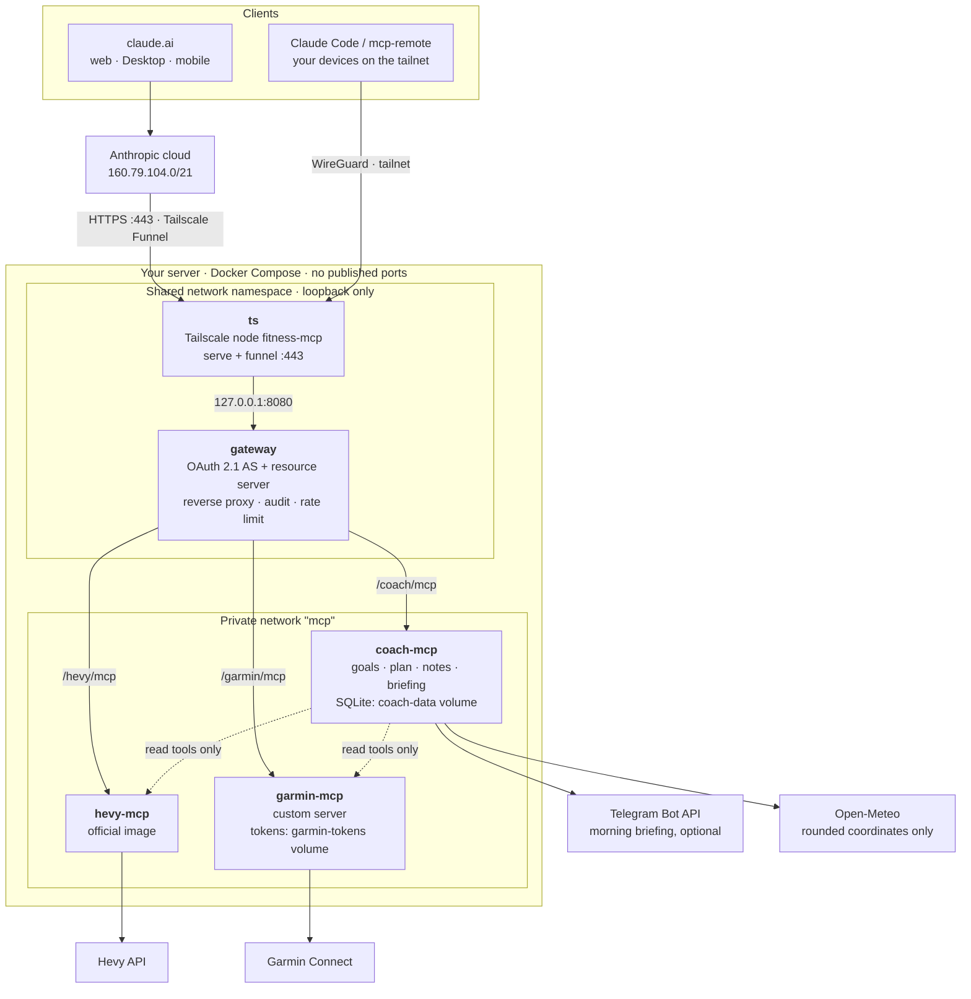

# fitness-coach-mcp

A self-hosted AI fitness coach for Claude. Three [MCP](https://modelcontextprotocol.io) servers give Claude
access to your real training data and a memory that survives between conversations. They run behind one
OAuth 2.1 gateway on your own server:

- **Garmin Connect** (`garmin-mcp/`, custom server on
  [`python-garminconnect`](https://github.com/cyberjunky/python-garminconnect) 0.3.17). It reads HRV, sleep,
  Body Battery, training readiness, activities (with the weather and the sets of strength sessions recorded on
  the watch), performance metrics (race predictions and their daily history, lactate threshold, heart-rate and
  power zones, VO2max), running tolerance, personal records, gear, body composition, nutrition and hydration. It
  can log a manual weigh-in and create structured run/ride workouts scheduled to the watch.
- **Hevy** (`hevy-mcp/`, upstream [`chrisdoc/hevy-mcp`](https://github.com/chrisdoc/hevy-mcp) 6.1.16). It covers
  strength-training history, routines, exercise templates and writing routines and workouts.
- **Coach memory** (`coach-mcp/`, custom server on SQLite). It stores goals, constraints (injuries, available
  days, equipment), a dated training plan with status, and a notes log. On top of that it computes:
  - a deterministic morning briefing (green / yellow / red), optionally pushed to Telegram;
  - goal progress (race predictions, VO2max) and a Monday weekly report in Telegram;
  - nightly Garmin and Hevy history for trends beyond 28 days, a weekly report, strength progress (estimated
    1RM) and correlations;
  - plan reconciliation against recorded activities;
  - a 7-day weather forecast with the best outdoor training windows.

It is built for one athlete (the owner) who does both strength and endurance training. All three servers are
reachable only through a dedicated Tailscale node. A typical conversation in a claude.ai Project: *"How am I
today, and what should I train this week?"* The coach reads recovery, load, the plan and its notes, proposes
the week and writes it to the plan, Garmin and Hevy only after you confirm.

> **Status:** a personal project, published as a reference implementation and portfolio piece. It is not a
> hosted service and not medical advice. The Garmin integration uses an unofficial library with your own
> credentials, which is fine for personal use but not for running a service for others. It is not affiliated
> with Garmin, Hevy, Tailscale or Anthropic.

**Contents:** [Demo](#demo) · [Design notes](#design-notes) · [Architecture](#architecture) ·
[Security model](#security-model) · [Installation](#installation) · [Adding the connectors](#adding-the-connectors) ·
[Operations](#operations) · [Troubleshooting](#troubleshooting) · [Repository layout](#repository-layout)

## Demo

One morning with the coach, start to finish. The numbers are synthetic; the tool names, the rules the coach
follows and the briefing text are the real ones. The briefing below was rendered by `coach-mcp`'s own
`build_briefing` from synthetic Garmin data.

**06:30 — the morning briefing arrives in Telegram** (computed by rules, no LLM; `COACH_LANGUAGE=en`, Czech
with `cs`):

```text
🟡 ⚠️ YELLOW · morning briefing 12 Oct

Verdict: yellow – cut volume by 20–30 %, intensity at most RPE 7–8, cardio in zone 2.
Readiness: 58 (yellow)
HRV: 49 ms, baseline 52–68 ms, below baseline 2 nights in a row (yellow)
Sleep: 6 h 24 min, score 71 (yellow)
Body Battery at wake: 46 (yellow)
For full load: readiness at least 70; HRV back to at least 52 ms; sleep at least 7 h; Body Battery at wake at least 50.
Today's plan:
- strength: Lower body A: back squat 4×5, RDL 3×8, split squat 3×10 (60 min)
Alerts:
- Resting HR 54 bpm, 5 above the 7-day average of 49 bpm.
```

**07:10 — in the claude.ai "Fitness coach" project:**

> **Athlete:** Got a yellow this morning. What should I do today, and can you plan the rest of the week?

<details>
<summary>Tool calls the coach makes before answering (all read-only)</summary>

| # | Tool | What it returns here |
|---|---|---|
| 1 | Coach `get_coach_context` | Goal: half marathon under 1:40 on 22 Nov; constraint: left knee, no deep lunges; this week's plan; yesterday's long run in `to_confirm` with suggestion `matched` |
| 2 | Coach `get_daily_briefing` | The verdict above with its numbers |
| 3 | Garmin `get_recovery_snapshot` | Fresh readiness, HRV, sleep, Body Battery, resting HR, training status |
| 4 | Garmin `get_hrv_trend` (14 days) | Two nights below the 52 ms baseline after a stable week around 60 ms |
| 5 | Garmin `list_activities` (7 days) | Sunday 18 km long run, acute load 1.1× chronic (optimal) |
| 6 | Garmin `get_performance_metrics` | Lactate threshold 4:35 /km at 168 bpm, half-marathon prediction 1:39:50, HR zones |
| 7 | Hevy `get-workouts`, `get-exercise-history` | Last squat session 4×5 at 100 kg, RPE 8 |
| 8 | Coach `get_weather_forecast` | Thursday 75 % rain all day; Friday best window 07:00–10:00, 9 °C |

</details>

> **Coach:** Where you are this morning:
> - Readiness **58** (yellow), HRV **49 ms**, under your 52–68 ms baseline for the **2nd night**.
> - Sleep **6 h 24 min**, Body Battery **46** at wake, resting HR **+5 bpm** over your 7-day average.
> - Load is fine: acute/chronic 1.1, so this looks like poor recovery (short sleep), not overreaching.
>
> **Today:** keep Lower body A but cut it by about 25 %: back squat **3×5 at 90 kg** (RPE 7, not 4×5 at
> 100 kg), RDL 2×8. Dropping split squats entirely: your knee constraint says no deep lunges, and today is not
> the day to test it. Full load again once readiness is ≥ 70 and HRV is back above 52 ms.
>
> **The rest of the week** (the threshold run moves from Thursday to Friday because of the rain):
>
> | Day | Session | Target and why |
> |---|---|---|
> | Tue | Easy run 45 min | Zone 2, HR ≤ 148 (your `running` zones) |
> | Wed | Upper body A | Normal load if tomorrow's verdict is green |
> | Thu | Mobility 30 min, indoors | 75 % rain all day; the indoor swap keeps intervals off a wet day |
> | Fri | Threshold 3×10 min, 3 min jog rest | 4:35–4:40 /km, 166–170 bpm, from your lactate threshold; 07:00–10:00 window |
> | Sat | Upper body B, light | No heavy legs the day before the long run |
> | Sun | Long run 16 km | Zone 2; down from 18 km while HRV recovers |
>
> Also, Sunday's 18 km long run matches a Garmin activity: shall I mark it **done**?
>
> Should I save this? That would: save the week to the plan, mark Sunday done, update today's routine in Hevy,
> and send Friday's threshold run to your watch.

> **Athlete:** Yes, save it all.

<details>
<summary>Writes, only after that confirmation</summary>

| Tool | Change |
|---|---|
| Coach `save_plan` | This week's sessions from today on (the replaced ones are kept as `superseded`) |
| Coach `update_session` | Sunday's long run → `done` |
| Hevy `search-exercise-templates`, `update-routine` | "Lower body A": squat 3×5 at 90 kg, RDL 2×8, split squat removed |
| Garmin `create_workout`, `schedule_workout` | "Threshold 3×10" with pace and HR targets, scheduled for Friday |
| Coach `add_note` | "Yellow day 12 Oct (short sleep, HRV 2 nights below baseline): lower body cut 25 %, threshold moved to Fri for rain." |

</details>

> **Coach:** Done. Sync your watch to get Friday's run. I'll check tomorrow's verdict before Wednesday's upper
> body session.

## Design notes

The parts most relevant to building LLM agents that act on real, personal data:

- **Tools designed for a model, not a REST mirror.** About 20 curated Garmin tools return compact,
  coach-oriented JSON instead of raw API payloads. A section Garmin cannot provide comes back as `"error"` or
  `"available": false` instead of failing the whole call. Tool descriptions and the servers' MCP
  `instructions` tell the model which tool to call first and when (for example, read performance metrics
  before prescribing paces).
- **Deterministic where it matters.** The morning verdict is a pure function with fixed thresholds, not an LLM
  judgement. The push notification and the `get_daily_briefing` tool call the same code, so they cannot
  disagree. A missing input never makes the verdict greener: it caps it at yellow and says what is missing.
- **Memory outside the model.** Goals, constraints, the plan and notes live in SQLite with FTS5 search. The
  coach is told to search its memory before asking the athlete again. Nothing is hard-deleted: goals end as
  achieved or abandoned, constraints as resolved, replaced sessions as superseded.
- **Human in the loop for every write.** Every tool that changes Garmin, Hevy or coach state says so in its
  MCP annotations and description. The [coach instructions](docs/coach-instructions.md) require showing the
  proposal and getting explicit confirmation first. Plan reconciliation only *suggests* a session status from
  recorded activities, and the athlete confirms it.
- **Least privilege between components.** The coach server reads Garmin with a separate read-only token, so
  `garmin-mcp` rejects its write tools before they run. It may call only two read tools on Hevy. The client's
  OAuth token is never forwarded to a backend.
- **Honest statistics.** `get_correlations` returns Pearson and Spearman with the number of paired days, refuses
  below 14 pairs, and carries a "correlation is not a cause" caveat that the instructions require the coach
  to repeat.
- **Tested offline.** About 770 test functions run against fakes and canned payloads, with no network. An
  end-to-end test runs the full OAuth + MCP flow in a throwaway Compose project (`scripts/check.sh`).
- **Plan-driven, AI-assisted development.** The project was built in small reviewed PRs from a written plan
  ([`mao-plan.md`](mao-plan.md): decisions, boundaries and a brief for each PR), largely with Claude Code.

## Architecture



The `ts` sidecar runs `tailscale/tailscale` v1.102.5 in userspace mode as the node `fitness-mcp` (tag
`tag:fitness-mcp`). The backends make only the outbound calls shown; nothing on the server accepts inbound
connections except through `tailscale serve`.

Connector URLs (the same from claude.ai and from the tailnet; inside the tailnet MagicDNS returns the 100.x
address). `<tailnet>` is your tailnet's DNS suffix: `tailscale status --json | jq -r .MagicDNSSuffix`, e.g.
`tail1234ab.ts.net`.

- `https://fitness-mcp.<tailnet>/hevy/mcp`
- `https://fitness-mcp.<tailnet>/garmin/mcp`
- `https://fitness-mcp.<tailnet>/coach/mcp`

Why a dedicated node rather than Funnel on the host: claude.ai calls connectors only on port 443, and Funnel
is enabled for a whole port. A dedicated node leaves whatever the host already serves on :443 (for example,
tailnet-only) untouched, and the gateway does not have to publish any port on the host.

## Security model

| Layer | What it does |
|---|---|
| Network | No published port on the host. The gateway listens only on 127.0.0.1 in the sidecar's namespace, so the only way in is `tailscale serve`. Backends are only on a private Docker network. They call out only to their own APIs (Hevy, Garmin Connect). `coach-mcp` optionally calls the Telegram Bot API (`api.telegram.org`) for the morning briefing (see Operations → Morning briefing) and Open-Meteo (`api.open-meteo.com`, no key) for the weather forecast, which receives only rounded coordinates (see Operations → Weather). Other host services and the host's own `tailscale serve` are not changed. |
| Funnel | Only discovery (`/.well-known/*`), the 401 response and `/token` are public. Anything carrying a token, and `/token` itself, passes through Funnel only from `160.79.104.0/21` (Anthropic's published outbound range for MCP connectors). |
| Login | `/authorize` (argon2id password + TOTP) only from your own tailnet devices (`Tailscale-User-Login` = `OWNER_TAILSCALE_LOGIN`, never through Funnel). Lockout with exponential backoff, TOTP code reuse protection, CSRF cookie. |
| OAuth | MCP auth spec 2025-11-25: PKCE S256 required. `resource` (RFC 8707) makes each token valid for one endpoint only (a Hevy token does not work on Garmin). `iss` (RFC 9207). Access token 1 h, refresh token 90 days, rotation with reuse detection (with a 120 s retry window). Revocation (RFC 7009). |
| Clients | No open registration (DCR). Allowed clients are listed in `gateway/config.toml`: Claude (claude.ai, CIMD), Claude Code (CIMD) and `mcp-remote`. CIMD documents are pinned (no runtime fetch, no SSRF), and `healthcheck.sh` watches for changes. |
| Backends | The client token is never forwarded. The gateway sends its own internal token per backend (`secrets/*_backend_token`). `coach-mcp` reads `garmin-mcp` with its own read-only token (`secrets/garmin_readonly_token`). `garmin-mcp` rejects any tool not marked as read-only (`create_workout`, `schedule_workout`, `unschedule_workout`, `log_weight`) before it runs. The Hevy tool `feedback` (sends a report to its author) is blocked. `coach-mcp` reads `hevy-mcp` directly with its internal token and may call only two read tools (`get-workout-events`, `get-exercise-template`). The `hevy-mcp` token has full rights, so only this allowlist in code keeps the coach from writing to Hevy. |
| Tokens | Opaque 256-bit. SQLite stores only their SHA-256 hash. |
| Containers | Non-root (uid 10001), `read_only`, `cap_drop: ALL`, `no-new-privileges`, memory and process limits, healthchecks, log rotation. Images pinned by `tag@sha256`, Python dependencies hash-locked. |
| Secrets | `secrets/` (0700, files 0640 with group 10001), Docker secrets. Never in git, env or logs. |
| Audit | `/data/audit.jsonl` + stdout: logins, token issue/refresh/revocation, every MCP call (method, tool, outcome, duration). Never arguments, results, tokens or passwords. |

## Installation

Prerequisites:

- A Linux server with Docker and Compose v2, joined to your tailnet. Tested on Ubuntu 24.04, linux/arm64
  (Oracle Cloud Ampere); all base images are multi-arch.
- A Tailscale account with MagicDNS and HTTPS certificates enabled (admin console → DNS).
- A Claude plan with custom connectors, Hevy PRO (for the API key), a Garmin Connect account.
- Tailscale running on the Mac/PC you connect the connectors from.

### 0. Clone

```bash
git clone <url-of-this-repo> fitness-coach-mcp && cd fitness-coach-mcp
```

All further commands run from the repository root.

### 1. Tailscale policy (admin console → Access controls)

Add a tag for the new node and allow Funnel for it. Tagged nodes are not part of `autogroup:member`, hence
the explicit `nodeAttrs`:

```jsonc
"tagOwners": {
  "tag:fitness-mcp": ["autogroup:admin"]
},
"nodeAttrs": [
  // ...keep your existing entries...
  { "target": ["tag:fitness-mcp"], "attr": ["funnel"] }
]
```

If your policy does not allow everything to everyone, also allow access from your devices:
`{"src": ["autogroup:member"], "dst": ["tag:fitness-mcp"], "ip": ["tcp:443"]}` in `grants`.

### 2. Auth key

Admin console → Settings → Keys → **Generate auth key**: Reusable **no**, Ephemeral **no**, Pre-approved
**yes**, Tags **`tag:fitness-mcp`**. The key is needed only for the node's first login (key expiry is disabled
for tagged nodes; the `ts-state` volume keeps the state).

### 3. Configuration

```bash
cp .env.example .env && chmod 600 .env
```

In `.env`, fill in `PUBLIC_BASE_URL` (`https://fitness-mcp.<tailnet>`) and `OWNER_TAILSCALE_LOGIN` (your
Tailscale login, e.g. `jane@github`). The commands that print both values are in `.env.example`. If you do
not live in the `Europe/Prague` time zone, set `ATHLETE_TZ` (e.g. `Europe/London`). It decides what "today"
is, and when the morning briefing and the nightly history run. `COACH_LANGUAGE` picks the language of the
morning briefing (`en` by default, or `cs`).

Optional settings:
- Morning briefing to Telegram: `COACH_TELEGRAM_CHAT_ID` and `COACH_BRIEFING_*` (see Operations → Morning
  briefing).
- Nightly Garmin history is on by default; its `COACH_HISTORY_*` options are in `.env.example` (see
  Operations → Nightly history).
- Backups: set `BACKUP_DIR` (an absolute path outside the repository) and optionally `BACKUP_KEEP` (see
  Operations → Backups).
- Location for the weather forecast: `COACH_HOME_LATITUDE` and `COACH_HOME_LONGITUDE` (see Operations →
  Weather).

### 4. Secrets

```bash
scripts/setup-secrets.sh
```

The script asks (hidden input) for the auth key, the Hevy API key (verified against the Hevy API right away)
and the gateway password, and sets up TOTP (QR code in the terminal + verification with a code). It
generates the internal tokens between the gateway and the backends, and the read-only token `coach-mcp` uses
to read `garmin-mcp`.

### 5. Start

```bash
docker compose up -d --build
docker compose ps          # all services healthy
```

The `fitness-mcp` node appears in the admin console with the `tag:fitness-mcp` tag. Funnel turns on by
itself from `tailscale/serve.json` (`AllowFunnel`).

### 6. Garmin login (once, interactively over SSH)

```bash
scripts/garmin-login.sh            # email, password, MFA code; the password is not stored
scripts/garmin-login.sh --check
```

### 7. Verification

```bash
scripts/healthcheck.sh             # containers, node, Funnel, discovery, tailnet-only login, Garmin, Hevy, coach database
scripts/smoke-test.sh              # tools/list on all three endpoints, coach memory summary, last 3 Hevy workouts, today's HRV/sleep, race predictions and HR zones, running tolerance, strength sets and activity weather
```

## Funnel

- It is enabled declaratively in `tailscale/serve.json` (`"AllowFunnel": {"${TS_CERT_DOMAIN}:443": true}`) and
  only on the `fitness-mcp` node. Nothing changes on the host.
- Status: `docker compose exec ts tailscale --socket /tmp/tailscaled.sock funnel status`
- To turn it off (tailnet only; claude.ai then cannot reach the connectors), delete the `AllowFunnel` block
  from `serve.json`. The sidecar watches the file, so the change applies by itself.
- The node's public DNS name can be discovered (Certificate Transparency). The model accounts for that:
  nothing sensitive is public.

## Adding the connectors

### claude.ai (web; also applies to mobile and Desktop)

1. On your Mac (or phone) **with Tailscale on**, open claude.ai → Settings → Connectors → **Add custom
   connector**.
2. Name `Hevy`, URL `https://fitness-mcp.<tailnet>/hevy/mcp`. Leave the OAuth Client ID/Secret empty (claude.ai
   identifies itself with CIMD) → **Add** → **Connect**.
3. The gateway's login page opens: enter the password + TOTP code → **Allow**.
4. The same for `Garmin`, URL `https://fitness-mcp.<tailnet>/garmin/mcp`.
5. The same for `Coach`, URL `https://fitness-mcp.<tailnet>/coach/mcp`.
6. Create a project (e.g. "Fitness coach") and enable all three connectors in it. The Custom Instructions are
   in [`docs/coach-instructions.md`](docs/coach-instructions.md).
7. Optionally, enable the built-in **Google Calendar** connector in the project (Settings → Connectors). The
   coach then checks free slots before proposing times and offers to create events after you confirm.
   Without it everything works the same, and the coach asks you for a time.

The connectors appear in Claude Desktop and the mobile app automatically (calls always come from Anthropic's
cloud through Funnel). You need to log in only when connecting for the first time, when the refresh token
expires (90 days without use) or when you revoke the grant.

### Claude Code (over the tailnet)

```bash
claude mcp add --transport http hevy   https://fitness-mcp.<tailnet>/hevy/mcp
claude mcp add --transport http garmin https://fitness-mcp.<tailnet>/garmin/mcp
claude mcp add --transport http coach  https://fitness-mcp.<tailnet>/coach/mcp
# in Claude Code: /mcp → pick the server → Authenticate (opens the browser with the gateway login)
```

Claude Code identifies itself with CIMD and uses the callback `http://localhost:<port>/callback` (allowed in
`gateway/config.toml`). It works only with Tailscale on; the gateway rejects tokens from the public internet
outside Anthropic's range.

### Claude Desktop locally over the tailnet (without Anthropic's cloud)

The claude.ai connectors work in Desktop by themselves. If you want a connection purely over the tailnet, add
this to `~/Library/Application Support/Claude/claude_desktop_config.json` (requires Node.js on the Mac):

```json
{
  "mcpServers": {
    "hevy-tailnet": {
      "command": "npx",
      "args": ["-y", "mcp-remote@0.14.3", "https://fitness-mcp.<tailnet>/hevy/mcp",
               "--static-oauth-client-info", "{\"client_id\":\"mcp-remote\"}",
               "--resource", "https://fitness-mcp.<tailnet>/hevy/mcp"]
    },
    "garmin-tailnet": {
      "command": "npx",
      "args": ["-y", "mcp-remote@0.14.3", "https://fitness-mcp.<tailnet>/garmin/mcp",
               "--static-oauth-client-info", "{\"client_id\":\"mcp-remote\"}",
               "--resource", "https://fitness-mcp.<tailnet>/garmin/mcp"]
    },
    "coach-tailnet": {
      "command": "npx",
      "args": ["-y", "mcp-remote@0.14.3", "https://fitness-mcp.<tailnet>/coach/mcp",
               "--static-oauth-client-info", "{\"client_id\":\"mcp-remote\"}",
               "--resource", "https://fitness-mcp.<tailnet>/coach/mcp"]
    }
  }
}
```

`mcp-remote` is pinned (the repository changed maintainers in August 2026). After restarting Desktop, the
gateway login opens.

## Operations

| Task | Command |
|---|---|
| Status of the whole service | `scripts/healthcheck.sh` (for cron: `--quiet`, exit 1 = problem) |
| Logs | `docker compose logs -f gateway` (no query strings or tokens) |
| Audit | `scripts/admin.sh audit 100` |
| Connected clients (grants) | `scripts/admin.sh grants list` |
| Disconnect a client | `scripts/admin.sh grants revoke <id>` (or `--all`) |
| Rotate the Hevy key | generate a new one in Hevy → `scripts/setup-secrets.sh hevy-key` (verifies it and restarts hevy-mcp) |
| Change the password / new TOTP | `scripts/setup-secrets.sh password` / `scripts/setup-secrets.sh totp` |
| Rotate internal tokens | `scripts/setup-secrets.sh backend-tokens` (including the read-only token `coach-mcp` uses for `garmin-mcp`) |
| Morning briefing by hand | `docker compose exec coach-mcp python -m coach_mcp send-briefing` |
| Weekly report by hand | `docker compose exec coach-mcp python -m coach_mcp send-weekly-report` |
| Nightly history (progress) | `docker compose logs coach-mcp` (lines `history status=…`) |
| Backup | `scripts/backup.sh` (for cron: `--quiet`, exit 1 = no archive was created) |
| Telegram bot | `scripts/setup-secrets.sh telegram-token` (token from @BotFather, prints the chat id), `scripts/setup-secrets.sh telegram-chat-id` (the chat id again) |
| New versions | `scripts/check-updates.sh` |
| Test without touching production | `scripts/e2e-test.sh` (separate Compose project, no internet, no Tailscale) |
| Full check (tests + e2e) | `scripts/check.sh --tag <tag>` (ends with the line `CHECK OK tree=…`) |

`scripts/e2e-test.sh` runs as the Compose project `fcm-e2e` with images `fcm-e2e/<service>:test`. The variables
`E2E_PROJECT` (`fcm-e2e` or `fcm-e2e-<suffix>`) and `E2E_TAG` give a run its own project and images, so two e2e
tests can run at the same time: `E2E_PROJECT=fcm-e2e-pr07 E2E_TAG=pr07 scripts/e2e-test.sh`. Networks and volumes
carry the project prefix, and no service publishes a port on the host.

`scripts/check.sh` is the single command for checking a change. It builds the test stages of `garmin-mcp`,
`gateway` and `coach-mcp` (`docker build --target test --no-cache-filter test`, so the tests really run), then
runs the e2e test with `E2E_PROJECT=fcm-e2e-<tag>` and `E2E_TAG=<tag>`.
- The tag is `--tag`, else `CHECK_TAG`, else `local`.
- Every build and the e2e run hold the lock `/tmp/fcm-docker.lock` (`CHECK_LOCK=0` turns it off). It does not
  read `.env`.
- Logs go to a temporary directory printed at the start. On failure it names the step and prints the last 40
  lines of its log.
- The last line on success is `CHECK OK tree=<HEAD tree, 12 chars>[-dirty] garmin=<n> gateway=<n> coach=<n>
  e2e=OK` (`n` = number of passed tests, `-dirty` = uncommitted changes).
- `--only garmin|gateway|coach|e2e` runs a subset (`CHECK PARTIAL`). `--keep-images` keeps the built images
  `fcm-<service>-check-<tag>` and `fcm-e2e/*:<tag>`; otherwise they are removed.

Recommended cron (reports only on problems):

```cron
17 7 * * * cd /path/to/fitness-coach-mcp && scripts/healthcheck.sh --quiet
47 2 * * * cd /path/to/fitness-coach-mcp && scripts/backup.sh --quiet
```

### Morning briefing (Telegram)

Once a day, `coach-mcp` can send a short briefing to your chat with your own Telegram bot. It contains:
- a green / yellow / red verdict by the rules in section 2 of `docs/coach-instructions.md`;
- the numbers behind it (readiness, HRV vs. baseline, sleep, Body Battery);
- today's plan from the coach memory;
- new alerts: HRV below baseline 3+ nights, resting HR 5+ bpm above its 7-day average, load outside Garmin's
  optimal range, yesterday's missed workout in Garmin's calendar and in the coach plan, an invalid Garmin
  login.

It is computed without an LLM, and the `get_daily_briefing` tool computes it the same way from current Garmin
data. The text is in English by default; `COACH_LANGUAGE=cs` switches it to Czech (catalogue in
`coach-mcp/src/coach_mcp/messages.py`).

**Privacy:** the messages contain health data and the Monday report also your goal titles. They leave your server
and tailnet for Telegram's servers and stay in the chat history until you delete them; bot chats are not
end-to-end encrypted. The bot token (`secrets/telegram_bot_token`) gives full control of the bot. If it leaks,
revoke it with @BotFather and store the new one with `scripts/setup-secrets.sh telegram-token`.

To turn it on:

1. In Telegram, send @BotFather `/newbot` and choose the bot's name and username; you get its token. Then send
   your new bot any message (e.g. `/start`); until you do, the bot cannot write to you.
2. `scripts/setup-secrets.sh telegram-token` stores the token (hidden input, verified with Telegram), prints
   the chat id of your chat with the bot (again: `scripts/setup-secrets.sh telegram-chat-id`) and restarts
   `coach-mcp`. An empty `secrets/telegram_bot_token` is already created by `scripts/setup-secrets.sh`;
   `coach-mcp` does not start without it.
3. Add `COACH_TELEGRAM_CHAT_ID=` with that number to `.env` (the time and other options are in `.env.example`).
4. `docker compose up -d --build coach-mcp`

The message is plain text; the first line is the verdict with a coloured circle and the date (`🟡 YELLOW ·
morning briefing 7 Oct`, with `⚠️` when there are new alerts). To turn the briefing off, remove
`COACH_TELEGRAM_CHAT_ID` from `.env` and run `docker compose up -d coach-mcp`.

The briefing goes out at `COACH_BRIEFING_TIME` (default 06:30, time zone `TZ`). When the watch does not have
sleep or HRV yet, it retries every `COACH_BRIEFING_RETRY_MINUTES` minutes (15). At `COACH_BRIEFING_CUTOFF`
(09:30) at the latest, it sends what it has and says what is missing. When Garmin is not logged in, it sends
the briefing right away. If the service starts after the cutoff, nothing is sent that day. By hand (e.g. for
a test; the alert state does not change):

```bash
docker compose exec coach-mcp python -m coach_mcp send-briefing
```

The scheduler log (`docker compose logs coach-mcp`) contains only outcomes (`briefing status=sent|waiting|skipped|
gave_up`, `push status=…`, `garmin status=…`), never the message content, numbers, chat id or token. A manual
`send-briefing` runs as a separate process: it prints the same lines to the terminal only, not to the
container log.

**Monday report.** On Mondays, right after the briefing, a second message follows: last week's numbers from
`get_weekly_report` (endurance, strength, sleep, HRV, resting HR, plan, new bests and watch-outs) and the
progress of your goals with a metric (`get_goal_progress`). It goes out once per ISO week (the week it reports)
and never without the briefing: when the briefing was not sent that day (it gave up, or the service started after
the cutoff), there is no Monday report that week. It uses the same retry interval and cutoff as the briefing.
`COACH_WEEKLY_PUSH=false` in `.env` turns it off (the briefing stays). By hand, for a look at the last complete
week on any day (no state is written, the setting is ignored):

```bash
docker compose exec coach-mcp python -m coach_mcp send-weekly-report
```

The log words are `weekly status=sent|waiting|skipped|gave_up|crashed|state_error`.

### Nightly history

`get_hrv_trend` reaches only 28 days back and `get_body_battery` 31. So the coach can see further, `coach-mcp`
stores the daily Garmin values every night (03:30) in SQLite in the `coach-data` volume: HRV, sleep, resting
HR, Body Battery, stress, readiness, load, VO2max and activity totals per sport.
- `get_trends` reads them by day, week or month.
- `get_weekly_report` builds the weekly review from them.
- `get_correlations` computes correlations (association, not cause).
- `get_goal_progress` follows the goals that have a metric: Garmin's race predictions and running VO2max.

Once a night, after the Garmin part, one more call (`get_race_predictions`) fetches Garmin's daily race
predictions for the missing range (on the first run the whole backfill range) into the same database. Its log
line is `history status=… part=predictions days=… ms=…`. A failed call changes nothing, and the next night asks
for the whole missed range again.

The data stays on the server, so no personal data is newly exposed. From the stored activities the server
suggests a status for the planned sessions of the last 7 days every night (`matched` / `no_activity`). It
never changes the status itself; the coach confirms it with `update_session`.

The first run is the largest. A minute after deployment it starts loading 90 days back: about 471 Garmin
Connect calls in 104 `garmin-mcp` calls (one of them for the race predictions of the whole range) with a 15 s
pause, roughly 30 minutes in total. After that it is about 17 calls a night (one for the race predictions), plus
at most 5 answered repair calls for days on which Garmin answered a section with an error (they are asked for
again on later nights, see `coach-mcp/README.md`). Nothing is called between
`COACH_BRIEFING_TIME` and `COACH_BRIEFING_CUTOFF`, so the morning briefing and the history do not share Garmin's
rate limit; the run continues after the cutoff. If `COACH_HISTORY_TIME` falls inside this window, the nightly run
starts only at `COACH_BRIEFING_CUTOFF` (logged once as `history status=config_warning`).

To turn it off: `COACH_HISTORY_ENABLED=false` in `.env` and `docker compose up -d coach-mcp` (stored data
stays, it just stops being extended). The other `COACH_HISTORY_*` options are in `.env.example`.

**Strength workouts from Hevy.** After Garmin, the same run reads, through `hevy-mcp`, the workouts changed
since the last complete run, including edited and deleted ones (`get-workout-events`, 10 per page). For each
exercise it reads its template once, to get the primary muscle group (`get-exercise-template`).
- Only a per-exercise summary is stored (working sets, volume in kg, the best set and its estimated 1RM by
  Epley), not individual sets. Warm-up sets are not counted.
- The first run reads the same `COACH_HISTORY_BACKFILL_DAYS` days back with the same pause between calls (one
  call per 10 workouts and one per exercise). Later nights usually take one call.
- When Hevy or `hevy-mcp` does not work, the Garmin part finishes normally and the strength data stays
  uncovered (`available: false`). The next attempt is in an hour, or in 1 to 8 hours when rate-limited;
  nothing is given up.
- For Hevy the log has a second line, `history status=… part=strength workouts=… deleted=… templates=…
  failed=… skipped=… ms=…` (`skipped` = Hevy events that could not be used). It runs before plan
  reconciliation, so it appears in the log before the Garmin line.

The log (`docker compose logs coach-mcp`) has one Garmin line per run, `history status=done|partial|
paused|rate_limited|service_error|auth|unreachable|no_credentials fetched=… failed=… pending=… given_up=…
ms=… repaired=…`, never data or values (`repaired` = days whose missing sections loaded in a repair call). With
`COACH_HISTORY_TIME` inside the briefing window there is also one
`history status=config_warning` line after startup. `healthcheck.sh` reports the job state (`on` / `off` /
`stopped`).

### Weather

`get_weather_forecast` returns a 7-day forecast from [Open-Meteo](https://open-meteo.com/). Per day it gives
sunrise and sunset, a summary (minimum and maximum temperature, feels-like temperature, highest precipitation
probability and wind) and hourly temperature, feels-like temperature, precipitation probability and wind (°C,
%, km/h, local times of the place).

For each day it adds the single best window for outdoor training: the longest continuous run of daylight hours
(at least 30 minutes of the hour between sunrise and sunset) that have not started yet, with a feels-like
temperature of −5 to 25 °C, precipitation probability at most 30 % and wind at most 25 km/h. On a tie, the
lower precipitation probability wins, then the earlier window.

- **Privacy:** only rounded coordinates (two decimals, about 1 km) and the server's IP address go to
  Open-Meteo, no health data. The service is free for non-commercial use and needs no key.
- **Setup:** add `COACH_HOME_LATITUDE` and `COACH_HOME_LONGITUDE` to `.env` (decimal degrees, e.g. 51.48 and
  0.00; both or neither), then `docker compose up -d coach-mcp`. Without them the tool returns only the error
  "No home location configured"; coordinates given as arguments (travel) always work. An invalid value stops
  `coach-mcp` from starting with a clear error.
- **Cache:** a response is kept in memory for 30 minutes (gone after a restart); errors are not cached.
- **Log** (`docker compose logs coach-mcp`): `weather status=fetched|error reason=…`, never with coordinates.
- **Calendar:** the Google Calendar connector is built into claude.ai and optional. Nothing in this repository
  handles it; the coach works with it according to [`docs/coach-instructions.md`](docs/coach-instructions.md).

Weather data by [Open-Meteo.com](https://open-meteo.com/) (CC BY 4.0 licence).

### Renewing Garmin tokens

The server refreshes its access token by itself and makes a cheap call about every 6 hours so that the refresh
token rotates too. A new login is needed when Garmin invalidates the tokens (long inactivity, a password
change, a change of Garmin's login flow). You will see it in `healthcheck.sh`, or the Garmin tools return an
error saying to run `scripts/garmin-login.sh`.

```bash
scripts/garmin-login.sh            # new login with MFA
```

When Garmin blocks logins from the server (HTTP 429), log in on your Mac and transfer only the token file. The
library needs Python ≥ 3.12 (the macOS system Python is 3.9), hence [uv](https://docs.astral.sh/uv/), which
downloads Python by itself. On the Mac, one line at a time (zsh treats `#` as a comment only after
`setopt interactivecomments`):

```bash
curl -LsSf https://astral.sh/uv/install.sh | sh
scp <vps>:fitness-coach-mcp/garmin-mcp/src/garmin_coach_mcp/login.py /tmp/garmin_login.py
uv run --python 3.13 --with garminconnect==0.3.17 python /tmp/garmin_login.py --tokens-dir ~/garmin-tokens
scp ~/garmin-tokens/garmin_tokens.json <vps>:/tmp/garmin_tokens.json
rm -rf ~/garmin-tokens /tmp/garmin_login.py
```

On the VPS:

```bash
scripts/garmin-login.sh --import /tmp/garmin_tokens.json && shred -u /tmp/garmin_tokens.json
```

Garmin often rejects the mobile login variants with 429; the library then tries the web widget by itself,
which usually works. When all variants return 429, wait at least an hour (further attempts extend the block)
and try once, ideally over a mobile hotspot.

When the Garmin login breaks for everyone (a change on Garmin's side), watch
[python-garminconnect](https://github.com/cyberjunky/python-garminconnect/issues). The fix usually means a
version bump in `garmin-mcp/pyproject.toml` → `scripts/lock-deps.sh` → rebuild → `garmin-login.sh`.

### Updates

Nothing updates by itself. The procedure:

1. `scripts/check-updates.sh`: what is new.
2. Change the pin (`tailscale/Dockerfile`, `hevy-mcp/Dockerfile` including the digest, or `pyproject.toml`).
   For Python, run `scripts/lock-deps.sh` (optionally `--upgrade`).
3. `scripts/check.sh` (tests of all services + e2e: build and the whole OAuth/MCP flow without touching
   production).
4. `scripts/setup-secrets.sh` adds the secrets a new version is missing (e.g. `secrets/garmin_readonly_token`
   or an empty `secrets/telegram_bot_token`). Without them the service that reads them does not start. On a
   complete installation it changes nothing.
5. `docker compose up -d --build` → `scripts/smoke-test.sh` → commit.

The Garmin read-only token (`secrets/garmin_readonly_token`): when you move to the version that introduces it,
step 4 creates it and restarts nothing. It takes effect only in step 5. `garmin-mcp` and `coach-mcp` must be
deployed together (`docker compose up -d --build garmin-mcp coach-mcp` is enough): an older `garmin-mcp` image
does not know the new token, and an older `coach-mcp` image looks for a token the new `docker-compose.yml` no
longer mounts for it. A second run of `setup-secrets.sh` changes nothing.

Digest for a new tag: `docker buildx imagetools inspect <image:tag>` (the `Digest` line).

### Backups

`fitness-coach-mcp_coach-data` is the **only copy** of the coach's goals, constraints, plan and notes, and no
script can recreate it. The gateway database (grants and refresh tokens) and the Garmin tokens can be recreated
(reconnect the connectors, `scripts/garmin-login.sh`), but a backup saves that work. Not included:
`audit.jsonl` (a log, not state), `ts-state` (a new auth key recreates the Tailscale node) and `secrets/`
(`scripts/setup-secrets.sh`).

**How.** `scripts/backup.sh` runs while the stack is up.
- It makes consistent copies of both databases with SQLite's online backup API inside their containers and
  copies the Garmin token.
- Everything goes into one archive, `fitness-coach-backup-<UTC time>.tgz` (mode 0600), in `BACKUP_DIR`.
- It keeps the newest `BACKUP_KEEP` archives (default 14) and never deletes other files in the directory.
- Any error (a service not running, missing Garmin tokens, a corrupt database) means exit 1, no archive, and
  older archives stay unchanged. Each problem is printed on its own line.
- Leftovers of an interrupted backup (`.backup-tmp.*`) are removed by the next run.
- Rotation never deletes the archive it just created. If the directory has an archive with a newer time in
  its name (clock moved, a foreign archive), the script says so even with `--quiet`.
- The name of the newest archive is the time of the last successful backup **in UTC**. A run at 02:47 in Prague
  is named `…T004700Z` in summer and `…T014700Z` in winter.

Setup: add `BACKUP_DIR=` (an absolute path outside the repository) and optionally `BACKUP_KEEP=` to `.env` with an
editor, run `scripts/backup.sh` once and add the cron line from Operations. The `backup`, `restore`,
`backup-db` and `restore-db` commands inside the containers exist only in images built from this version.
After an update, rebuild and restart the stack first (Updates, `docker compose up -d --build`). Older images
answer `restore` with a usage line only (exit 2) and change nothing.

**Where to keep them.** The archives contain personal training data and Garmin login tokens: keep them out of
the repository and out of public storage. Copying them off this machine (encrypted) is up to you; the script
does not do it.

**Restore** one part at a time, always with that part's service stopped, one command at a time. First set the
archive path (the name contains the time in UTC; use your own archive):

```bash
ARCHIVE=/srv/backups/fitness-coach-mcp/fitness-coach-backup-20261009T004700Z.tgz
```

Coach memory:

```bash
docker compose stop coach-mcp
tar -xzOf "$ARCHIVE" coach.db | docker run --rm -i --network none -v fitness-coach-mcp_coach-data:/data/coach fitness-coach-mcp/coach-mcp:0.1.0 restore
docker compose start coach-mcp
```

Gateway (grants):

```bash
docker compose stop gateway
tar -xzOf "$ARCHIVE" gateway.sqlite3 | docker run --rm -i --network none -v fitness-coach-mcp_gateway-data:/data --entrypoint python fitness-coach-mcp/gateway:0.1.0 -m gateway.cli restore-db
docker compose start gateway
```

Garmin tokens:

```bash
docker compose stop garmin-mcp
tar -xzOf "$ARCHIVE" garmin_tokens.json | docker run --rm -i --network none -v fitness-coach-mcp_garmin-tokens:/data/garmin --entrypoint python fitness-coach-mcp/garmin-mcp:0.1.0 -m garmin_coach_mcp.login --tokens-dir /data/garmin --import-file - --no-verify
docker compose start garmin-mcp
scripts/garmin-login.sh --check
```

A restore first verifies the file: SQLite integrity, the expected tables, and that the coach database schema is
not newer than the image.
- On any error, coach and gateway end with a line `… nothing changed`. The Garmin token import rejects an
  invalid file with `The file does not look like garmin_tokens.json …`. In all cases the volume stays as it
  was.
- On success, the previous files in the volume stay as `<file>.before-restore-<UTC time>`. That includes any
  leftover `-journal` / `-wal`, which SQLite would otherwise replay into the restored file.
- `coach-mcp` migrates an older coach database archive at startup and refuses a newer one (deploy a newer
  image).
- The Garmin tokens are replaced without a side copy (they can be recreated with `scripts/garmin-login.sh`);
  `--check` shows an expired token from the archive.
- On a new host, first start the stack according to Installation (`docker compose up -d --build`) so that
  Compose creates the volumes, and only then restore.
- When a command ends with an error, do not continue with the next one; after `docker compose start` the
  service runs with its existing data.

**Going back after a restore** (for the gateway likewise with `-m gateway.cli restore-db
/data/<file>.before-restore-…`). The first command lists the side copies in the volume; restore from the one
with the time you want to go back to. The listing also shows `<file>.before-restore-<time>-journal` / `-wal` /
`-shm` files; `restore` gets the name **without** that suffix. Going back keeps the current database as another
side copy and consumes the `-journal` / `-wal` / `-shm` of the chosen copy, because SQLite uses them when
reading it; the copy itself stays.

```bash
docker run --rm --network none -v fitness-coach-mcp_coach-data:/data/coach --entrypoint ls fitness-coach-mcp/coach-mcp:0.1.0 -l /data/coach
docker compose stop coach-mcp
docker run --rm --network none -v fitness-coach-mcp_coach-data:/data/coach fitness-coach-mcp/coach-mcp:0.1.0 restore /data/coach/coach.db.before-restore-20261009T101500Z
docker compose start coach-mcp
```

Delete side copies you no longer need:

```bash
docker run --rm --network none -v fitness-coach-mcp_coach-data:/data/coach --entrypoint sh fitness-coach-mcp/coach-mcp:0.1.0 -c 'rm -f /data/coach/coach.db.before-restore-*'
```

The same for the gateway:

```bash
docker run --rm --network none -v fitness-coach-mcp_gateway-data:/data --entrypoint sh fitness-coach-mcp/gateway:0.1.0 -c 'rm -f /data/gateway.sqlite3.before-restore-*'
```

The pattern also deletes the `-journal` / `-wal` / `-shm` helper files and the copy you just went back from.

The daily history (`history_days`) is in the same file as `coach.db`. If it is lost, `coach-mcp` reloads the
last `COACH_HISTORY_BACKFILL_DAYS` days from Garmin after startup. The Hevy strength history (tables
`strength_workouts`, `hevy_templates`, `hevy_sync`) is likewise reloaded from Hevy after a loss.

## Troubleshooting

| Symptom | Cause / fix |
|---|---|
| claude.ai: "Couldn't connect" right after adding | Funnel is not running or the funnel `nodeAttrs` for the tag is missing → `healthcheck.sh`. Public DNS: `curl -s -H 'accept: application/dns-json' 'https://cloudflare-dns.com/dns-query?name=fitness-mcp.<tailnet>&type=A'`. |
| The login page says "Access denied" | You came in over the internet, not the tailnet. Turn on Tailscale, turn off iCloud Private Relay / custom DNS-over-HTTPS in the browser (MagicDNS must work) and try again. |
| "Invalid password or code" | Check the time on your phone. Each TOTP code can be used only once. After 5 failures the login locks (1 min, then exponentially up to 1 h). |
| "Request expired" | The login page is valid for 10 min. Start connecting again from Claude. |
| A connector stops working after a while and asks for login | The refresh token expired or the grant was revoked (`scripts/admin.sh grants list --all` shows the reason, e.g. `refresh token reuse`). Reconnect from the tailnet. |
| MCP calls return 403 | The token came through Funnel from an IP outside `160.79.104.0/21`. For claude.ai this means Anthropic changed the range: check the [docs](https://platform.claude.com/docs/en/api/ip-addresses) and adjust `FUNNEL_TOKEN_CIDRS` in `.env`. |
| MCP calls return 502 `backend_misconfigured` | The gateway ↔ backend internal token does not match → `scripts/setup-secrets.sh backend-tokens`. |
| The gateway does not start after an update: `cannot read secret /run/secrets/coach_backend_token` | `scripts/setup-secrets.sh` (adds the missing internal token), then `docker compose up -d --build coach-mcp gateway`. |
| `coach-mcp` unhealthy, log says `database schema version N is newer` | An older image is running than the data: deploy the newer version again; do not delete the `coach-data` volume. |
| `scripts/backup.sh` ends with `No backup written` | The lines above name the part: `is not running` (Compose message) = the service is not running (`docker compose ps`); `Garmin tokens missing` = `scripts/garmin-login.sh`; `database is larger than 32 MiB` / `stayed locked` = report it (the limit is raised in a PR). No archive was created and older ones stay. |
| `coach-mcp` does not start: `bind source path does not exist: …/secrets/telegram_bot_token` | The bot token file is missing (an empty one is enough) → `scripts/setup-secrets.sh` and `docker compose up -d coach-mcp`. |
| `garmin-mcp` or `coach-mcp` does not start: `bind source path does not exist: …/secrets/garmin_readonly_token` | The coach's read-only token is missing → `scripts/setup-secrets.sh` and `docker compose up -d --build garmin-mcp coach-mcp`. |
| The briefing and history have no Garmin data, the `garmin-mcp` log says `read-only token file missing or too short` | `secrets/garmin_readonly_token` is empty → `scripts/setup-secrets.sh` fills it; running services pick up the new token by themselves. |
| `coach-mcp` keeps restarting, log says `COACH_TELEGRAM_CHAT_ID is set but … does not hold a Telegram bot token` | `.env` has a chat id but the token is missing or corrupt → `scripts/setup-secrets.sh telegram-token`, or delete the chat id from `.env` (briefing off). |
| `get_trends` / `get_weekly_report` have no data, `get_correlations` returns `too_few_pairs` | The history is still loading (first run ~30 min, outside the briefing window) or Garmin is not logged in: `docker compose logs coach-mcp`, lines `history status=…` (`rate_limited` = Garmin limited the calls, next attempt in 1 to 8 h; `auth` = `scripts/garmin-login.sh`; `service_error` = Garmin Connect or the internet did not work, next attempt in 1 to 8 h, the days do not count; `given_up` > 0 = days that failed three times although Garmin returned other days). |
| `get_goal_progress` shows `available: false` or a goal without a projection | `reason` says why. `available: false`: `no_recent_value` / `too_few_values` = no value in the last 14 days or fewer than 14 values over 4 weeks (the race predictions need a night of history first; `docker compose logs coach-mcp`, lines `part=predictions`). `available: true` without a projection: `no_target_date`, `target_date_passed`, `target_date_too_far` (needs a target date within 26 weeks), `trend_too_steep`; `no_target_value` = projection but no verdict (give `set_goal` a `target_value`). A goal without `metric` is not listed (give it one with `set_goal`). |
| `get_plan` has no `suggestion` on a past session | The session is not `planned`, is of type `mobility` / `other`, the day has not loaded yet (first the day after the session at 03:30), it is more than 7 days older than the deployment, or the history is off (`COACH_HISTORY_ENABLED=false`); see the `history status=… matched=… no_activity=…` line in `docker compose logs coach-mcp`. |
| `get_strength_progress` or the strength part of `get_weekly_report` has no data | The strength history is still loading or `hevy-mcp` does not work: `docker compose logs coach-mcp`, lines `history status=… part=strength` (`no_credentials` = the `coach-mcp` container has no `hevy_backend_token`, after an update run `docker compose up -d coach-mcp`; `unreachable` = `hevy-mcp` does not respond; `auth` = invalid Hevy key, `scripts/setup-secrets.sh hevy-key`; `rate_limited` = Hevy limited the calls, next attempt in 1 to 8 h; `service_error` = Hevy returned an error or an unexpected page, next attempt in 1 to 8 h). |
| `get_weather_forecast`: "No home location configured" | `COACH_HOME_LATITUDE` and `COACH_HOME_LONGITUDE` are missing from `.env` → add both and `docker compose up -d coach-mcp`; or pass coordinates as arguments. |
| `get_weather_forecast`: "Weather service unreachable / timed out / answered HTTP …" | Open-Meteo or the internet does not work. Errors are not cached, so the next call tries again; `docker compose logs coach-mcp`, lines `weather status=error`. |
| `coach-mcp` does not start, log says `COACH_HOME_… must be set together / must be a number / must be between` | Fix or delete both `COACH_HOME_LATITUDE` and `COACH_HOME_LONGITUDE` in `.env`. |
| `coach-mcp` does not start, log says `COACH_LANGUAGE must be one of en, cs` | Fix or delete `COACH_LANGUAGE` in `.env`. |
| The morning notification did not arrive | `docker compose logs coach-mcp`: `skipped` = the service started after the cutoff; `gave_up` = Telegram rejected the message (token, chat id, bot blocked or nobody has written to it yet) or did not respond; no `briefing` line = the briefing is off (`healthcheck.sh` says so). |
| Hevy tools return 401 | Invalid Hevy key or Hevy PRO expired → `scripts/setup-secrets.sh hevy-key`. |
| Garmin tools say to run scripts/garmin-login.sh | Tokens are missing or expired → `scripts/garmin-login.sh`. |
| Garmin login: 429 / 403 from Cloudflare | Blocked from a datacenter IP → log in on your Mac and import the tokens (see above). |
| Garmin data: 403 on every call | Try `GARMIN_API_SESSION=curl_cffi` on the garmin-mcp service (python-garminconnect #444 workaround). |
| The node does not log in | The auth key is used up / expired or has no tag → new key, `scripts/setup-secrets.sh ts-authkey`, `docker compose up -d --force-recreate ts gateway`. |
| The gateway does not work after restarting `ts` | The gateway shares its network namespace: `docker compose up -d --force-recreate gateway`. |
| `permission denied ... docker.sock` | The user is not in the docker group in the current session: log in again or `sg docker -c "<command>"`. |

## Repository layout

```
docker-compose.yml       services, hardening, networks, volumes, secrets
compose.test.yml         overlay for the e2e test (no Tailscale login, no internet)
.env.example             non-secret configuration (hostname, owner, UID/GID, morning briefing, weather location)
tailscale/               sidecar image (non-root) + serve.json with Funnel
gateway/                 OAuth 2.1 gateway (Python, Starlette), tests, config.toml
hevy-mcp/                wrapper around the official image (secrets from files, telemetry off)
garmin-mcp/              Garmin MCP server (Python, python-garminconnect + MCP SDK), tests
coach-mcp/               coach memory (Python, MCP SDK, SQLite), tests
scripts/                 setup-secrets, garmin-login, healthcheck, backup, smoke-test, admin, check-updates,
                         lock-deps; tests: check (the full check), e2e-test
docs/coach-instructions.md   Custom Instructions for the "Fitness coach" Claude project
mao-plan.md              the development plan: decisions, boundaries and one brief per PR
```

## License

[MIT](LICENSE). Weather data by Open-Meteo (CC BY 4.0).
